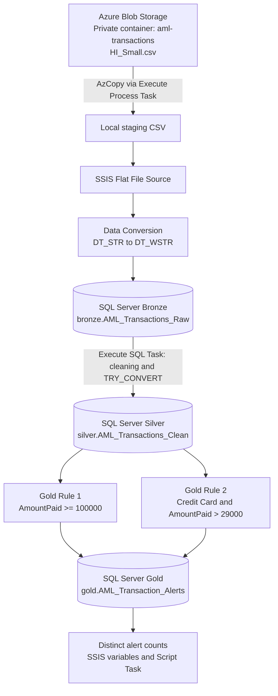
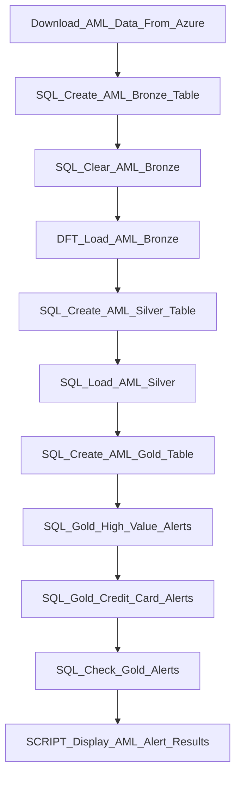

# Azure SSIS AML Transaction Monitoring Pipeline

  

A hybrid cloud-to-local **anti-money laundering (AML) transaction monitoring** demonstration built with **Azure Blob Storage, AzCopy, SQL Server Integration Services (SSIS), and SQL Server**. It ingests a synthetic transaction CSV, applies Bronze/Silver/Gold transformations, and generates explainable, rule-based alerts.

> **Project status:** Version 1 is implemented in a single SSIS package (`Package.dtsx`). Separating Bronze, Silver, and Gold into independently orchestrated packages is a planned enhancement.

## Architecture



### SSIS execution flow



## Technology stack

| Layer | Technology | Purpose |
|---|---|---|
| Cloud source | Azure Blob Storage | Stores the private source CSV |
| Secure transfer | AzCopy + Microsoft Entra authentication | Downloads source data to Windows staging |
| Orchestration | SSIS / Visual Studio | Runs ingestion, SQL transformations, and monitoring |
| Storage and transformation | Microsoft SQL Server | Implements Bronze, Silver, and Gold tables |
| Validation | T-SQL and SSIS Script Task (C#) | Counts records and displays monitoring results |
| Version control | GitHub | Shares project source and documentation |

## Data processing layers

**Bronze — Raw ingestion**
- Downloads `HI_Small.csv` from a private Azure Blob container to `C:\AML_Project\Staging`.
- Reads the CSV through an SSIS Flat File Source.
- Converts non-Unicode input strings to Unicode before inserting into `bronze.AML_Transactions_Raw`.
- Preserves original source fields as text and adds a generated row ID and load timestamp.
- Uses a full-refresh strategy (`TRUNCATE`) for this demonstration.

**Silver — Cleaning and typing**
- Loads `silver.AML_Transactions_Clean` from Bronze.
- Standardizes column names and trims whitespace.
- Converts amounts to `DECIMAL(20,2)`, laundering labels to `BIT`, and timestamps to `DATETIME2`.
- Uses `TRY_CONVERT` to avoid failing the entire load on invalid values.
- Parses source dates such as `09/01/2022 00:00` with SQL Server date style `101` (MM/DD/YYYY).
- Retains `RawTransactionID` for traceability.

**Gold — Rule-based alerts**
- Stores triggered alerts in `gold.AML_Transaction_Alerts`.
- Rule 1: `HIGH_VALUE_TRANSACTION` when `AmountPaid >= 100000`.
- Rule 2: `CREDIT_CARD_HIGH_AMOUNT` when `PaymentFormat = 'Credit Card' AND AmountPaid > 29000`.
- Counts **distinct transaction IDs** to avoid double-counting transactions that trigger multiple rules.
- Keeps the source `IsLaundering` label separate from rule conditions; the label is used only to compare alerts with known synthetic outcomes.

> **Important:** The numeric thresholds are illustrative, not regulatory requirements or production-ready AML controls. The current rules compare nominal amounts across currencies without FX normalization. The credit-card threshold was selected after inspecting a known labeled case, so results are subject to selection bias.

## Version 1 demonstration results

| Metric | Observed result |
|---|---:|
| Synthetic transactions loaded | **50,509** |
| Unique transactions flagged by either rule | **7,582** |
| Share of transactions flagged | **15.01%** |
| Known laundering cases in this sample | **2** |
| Known laundering cases flagged | **2** |
| Recall on these two known cases | **100%** |

These results describe **this sample only**. With just two labeled laundering cases, they do **not** establish generalizable AML detection performance. Unlabeled or non-laundering transactions flagged by the rules should not automatically be called confirmed false positives.

## Repository contents

The SSIS project should contain files similar to:

```text
azure-ssis-aml-monitoring-pipeline/
├── README.md
├── .gitignore
├── <solution-file>.sln                 # if present
└── <ssis-project-folder>/
    ├── <project-name>.dtproj
    ├── Package.dtsx                   # Version 1: all stages in one package
    └── Project.params                 # if present; review before committing
```

Replace the placeholder filenames above with the actual project structure. The dataset, local staging files, Azure tokens, passwords, and build artifacts should **not** be committed.

## How to run locally

### Prerequisites

- Windows with Visual Studio and the **SQL Server Integration Services Projects** extension.
- A running SQL Server instance and permission to create schemas/tables.
- AzCopy installed locally.
- Access to an Azure Blob container holding the synthetic AML CSV.
- Appropriate Microsoft Entra Blob data permissions (for example, **Storage Blob Data Reader**) or another secure authentication mechanism.

### Setup

1. Open the SSIS solution/project in Visual Studio.
2. Create a local SQL Server database named `AML_Cloud_ETL` (or adjust the SSIS connection manager to use your database).
3. Update the SSIS OLE DB connection manager for your SQL Server instance.
4. Configure the AzCopy executable path and source Blob URL in the Execute Process Task.
5. Set the Flat File Connection Manager to the actual local staging CSV path.
6. Authenticate AzCopy securely under the Windows identity that executes SSIS. An interactive login may not carry over to SQL Server Agent or another execution identity.
7. Run `Package.dtsx` and confirm successful task execution.
8. Validate record counts and inspect the Gold alerts.

**Security:** Never put storage keys, SAS tokens, connection passwords, or access tokens in the repository. Inspect `.dtsx`, `.dtproj`, `.conmgr`, and `.params` files before publishing, since SSIS configuration can contain sensitive values.

### Validation queries

```sql
USE AML_Cloud_ETL;

-- Verify source ingestion and Silver transformation.
SELECT COUNT(*) AS BronzeRows FROM bronze.AML_Transactions_Raw;
SELECT COUNT(*) AS SilverRows FROM silver.AML_Transactions_Clean;

-- Review alert counts by rule.
SELECT AlertRule, COUNT(*) AS AlertCount
FROM gold.AML_Transaction_Alerts
GROUP BY AlertRule;

-- Avoid double-counting transactions triggering multiple rules.
SELECT
    COUNT(DISTINCT RawTransactionID) AS UniqueFlaggedTransactions,
    COUNT(DISTINCT CASE WHEN IsLaundering = 1 THEN RawTransactionID END)
        AS KnownLaunderingCasesFlagged
FROM gold.AML_Transaction_Alerts;
```

## Design decisions and limitations

- **Single-package orchestration:** Easier to develop and debug initially; a master package with independent Bronze/Silver/Gold child packages is a planned improvement.
- **Full refresh:** Bronze is truncated before loading and Silver is reloaded from Bronze. This is appropriate for the demo snapshot, not for preserving production history.
- **Alert refresh:** Each Gold rule deletes and recreates alerts for its own rule identifier, preventing repeated-run accumulation for those rules.
- **Synthetic data:** The dataset is for learning and demonstration, not live banking monitoring.
- **Currency handling:** The rules currently compare raw amounts without conversion into a common currency.
- **Rule evaluation:** Only two labeled laundering examples are present; performance metrics should be interpreted cautiously.
- **Operational controls:** More complete error handling, automated audit logs, configuration management, and non-interactive authentication are future improvements.

## Planned enhancements

- Split the current package into `Bronze_Load.dtsx`, `Silver_Transform.dtsx`, and `Gold_AML_Monitoring.dtsx`, orchestrated by `Master_AML_ETL.dtsx`.
- Add ETL run IDs, row-count logging, error handling, and operational audit tables.
- Parameterize Blob URLs, staging paths, database connections, and monitoring thresholds.
- Add currency normalization, account-behavior rules, and independent evaluation data.
- Replace the interactive C# message box with logging or a reporting dashboard for unattended execution.

## Data attribution

This demonstration uses a local subset of the publicly available **IBM Transactions for Anti-Money Laundering** synthetic dataset, commonly distributed as `HI-Small_Trans.csv`. Consult the original dataset's distribution terms before publishing any source data. This repository is intended to share ETL code and architecture, **not** the raw dataset.

## Disclaimer

For educational and portfolio demonstration only. The alerts are not evidence of criminal activity, and the rules are not a substitute for regulatory AML compliance programs or professional investigation.
